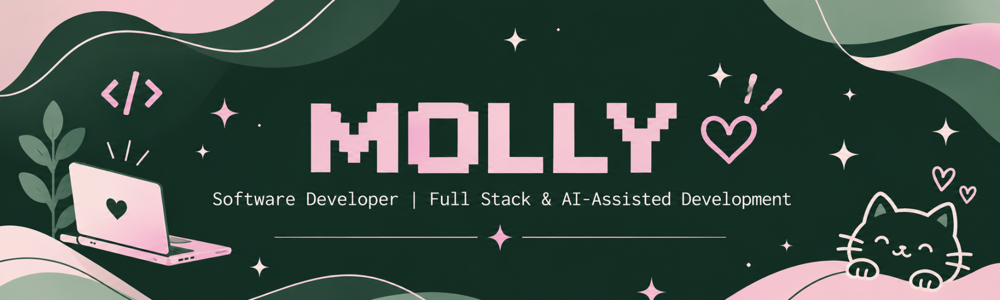

<!-- ===================================================== -->
<!--                      HEADER                           -->
<!-- ===================================================== -->

 

---

<!-- ===================================================== -->
<!--                      ABOUT ME                          -->
<!-- ===================================================== -->

## 🌷 About Me

I'm **Milagros Belén Lasschar**, a Software Developer with **4+ years of experience** building web applications and digital solutions across professional, freelance, academic, and personal projects.

My main technologies are **React, Next.js, TypeScript, JavaScript, and Node.js**.

I enjoy combining software development, AI-assisted solutions, automation, and user-centered design to transform ideas into functional digital products.

**A little more about me:**

- 💻 Software Development & Full Stack.
- 🤖 AI-assisted development and workflow automation.
- 🎨 UX/UI and Graphic Design.
- 🌱 Currently studying Systems Engineering and Graphic Design.
- 💗 Co-founder of STEAM Girls.
- 🌎 Interested in technology, collaboration, and continuous learning.

 

---

<!-- ===================================================== -->
<!--                      WHAT I DO                         -->
<!-- ===================================================== -->

## 🌟 What I Do

<table>
<tr>
<td width="50%" valign="top">

### 💻 Development

Building responsive and reusable web applications.

- React & Next.js
- TypeScript & JavaScript
- Node.js
- REST APIs
- Salesforce & Apex
- Testing with Jest

</td>
<td width="50%" valign="top">

### 🤖 AI & Automation

Exploring how AI can improve development and processes.

- n8n
- Workflow Automation
- Prompt Engineering
- AI-Assisted Development
- GitHub Copilot
- Cursor & ChatGPT

</td>
</tr>
<tr>
<td width="50%" valign="top">

### 🎨 UX/UI Design

Designing digital experiences with a user-centered approach.

- Figma
- Wireframing
- Prototyping
- Design Systems
- User Research
- Accessibility

</td>
<td width="50%" valign="top">

### 🌸 Graphic Design

Creating visual identities and communication materials.

- Adobe Illustrator
- Adobe InDesign
- Brand Identity
- Logo Design
- Typography
- Visual Composition

</td>
</tr>
</table>

---

<!-- ===================================================== -->
<!--                      TECH STACK                        -->
<!-- ===================================================== -->

## 🛠️ Tech Stack

### Languages & Frontend

### Backend, Database & APIs

- SQL & SOQL
- REST APIs
- WebSockets
- JSON & Webhooks
- Salesforce API

### Testing, Tools & Deployment

- Jest & Unit Testing
- Git & GitHub (Branches and Pull Requests)
- Postman
- Vercel & Netlify

### AI & Automation

  
  
  
  
  
   

### UX/UI & Graphic Design

- User Research & Requirements Analysis
- Wireframing & Prototyping
- User Flows & Information Architecture
- Design Systems
- Usability Testing
- Accessibility
- Visual Identity & Brand Design
- Typography & Visual Composition

### Project Management & Collaboration

- Scrum & Agile Methodologies
- Jira, Trello & Notion
- Task Tracking & Documentation
- Team Coordination
- Cross-functional Collaboration

---

<!-- ===================================================== -->
<!--                   GITHUB ANALYTICS                     -->
<!-- ===================================================== -->

## 📊 GitHub Analytics

 

---

<!-- ===================================================== -->
<!--                      COMMUNITY                         -->
<!-- ===================================================== -->

## 💗 Community & Leadership

### 🌸 STEAM Girls — Co-founder

I'm a co-founder of **STEAM Girls**, a community that supports women and femininities interested in entering and growing in the tech industry.

Through this initiative, I contribute to:

- Mentoring and career guidance.
- CV reviews and interview preparation.
- Introductory web development learning (HTML & CSS).
- Networking and professional connections.
- Community partnerships and technology events.
- Visual identity and communication design.

I also represent the community at technology events, collaborate with professionals, and help create opportunities for women in the tech ecosystem.

---

<!-- ===================================================== -->
<!--                      EDUCATION                         -->
<!-- ===================================================== -->

## 🎓 Education

| Education | Institution |
|:---|:---|
| Systems Engineering · In progress | UTN |
| Graphic Design · In progress | Federación Gráfica Bonaerense |

---

<!-- ===================================================== -->
<!--                    BEYOND TECH                         -->
<!-- ===================================================== -->

## 🎮 Beyond Technology

Outside of technology, I love:

- 🎮 Playing video games.
- 🎬 Watching anime.
- 🎵 Listening to music.
- 📚 Reading science fiction books.
- 🩰 Dancing ballet.

---

<!-- ===================================================== -->
<!--                       CONNECT                          -->
<!-- ===================================================== -->

## 🌐 Let's Connect!

I'm always open to learning, sharing ideas, and collaborating on interesting projects.

  

